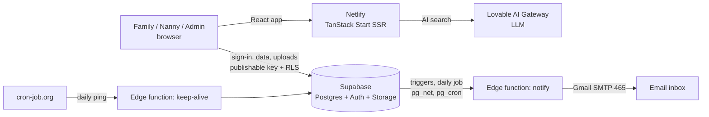

# askmynanny

**Care you can trust!** A verified nanny-hiring platform for Filipino families.

**Live app:** https://askmynanny.netlify.app

Most Filipino families still find a yaya through Facebook groups, where anyone can post a photo and a story. Nannies, in turn, run into fake job offers that ask them to pay fees. askmynanny makes **both sides prove who they are**: every nanny and every family verifies a government ID with a live photo, an admin reviews it, and only fully verified families can contact fully verified nannies.

> **Status:** in development. The full flow works end to end on the live site (sign-in, verification, admin review, verified-only contact, emails). Nanny profiles marked **Sample** in search are demo data until real nannies are verified.

---

## Features

| Area | What it does |
|---|---|
| **AI nanny search** | Families describe what they need in plain words ("live-in yaya in Cebu for a toddler, under ₱10,000"); the assistant suggests matching nannies and explains why. It refuses to match on age, gender or appearance (RA 10911). |
| **Philippines launch** | Metro Manila, Cebu, Davao and 13 more locations; salaries in pesos. |
| **Email sign-in (OTP)** | One-time code by email, no passwords. Users choose *Hiring a nanny* or *A nanny / kasambahay*. |
| **Identity verification** | **Required for everyone:** a valid government ID + a live camera photo holding it (no file upload, to stop reused photos). |
| **Optional clearances** | NBI, police, barangay clearance, medical, TESDA and first aid certificates earn public badges after admin approval. Under the Kasambahay Law (RA 10361 Sec. 12) the hiring employer may require these and pays for them; the app says so on every relevant page. |
| **Expiry tracking** | Documents with a "valid until" date: email reminder 4 weeks before, badge removed automatically on expiry. |
| **Admin review** | Compare live photo with ID, approve or reject each document with a note, verify profiles. Header badge shows how many are waiting. |
| **Verified-only contact** | Only fully verified families can message fully verified nannies. Enforced in the database, not just the UI. |
| **Minimum wage check** | Salaries below the confirmed kasambahay minimum (₱7,800 in Metro Manila, Wage Order NCR-DW-06) are blocked. |
| **Email notifications** | Admins: new submission to review. Registrants: received, verified, needs changes, document rejected, expiring. Nannies: a family sent a message. Emails never contain IDs, photos, phone numbers or message text. |

## How it works



- **Frontend:** TanStack Start (React 19, file-based routes), Tailwind CSS, shadcn/ui. Built with Vite and Bun.
- **AI:** a server function sends the family's request plus the nanny list (no age, gender or photos) to an LLM through the Lovable AI Gateway. Inputs are cleaned first (last 12 turns, 1,000 characters each) and the reply may only reference real nanny IDs.
- **Backend:** Supabase. Postgres with **row-level security on every table**, triggers that enforce the verification rules, private storage for IDs, Auth with email OTP.
- **Email:** the `notify` edge function, called by database triggers and a daily `pg_cron` job. Each email is logged under a unique key so it is never sent twice.
- **Hosting:** Netlify (from `main`). The repo also deploys on Lovable.

Database changes are recorded as SQL in [`docs/database/`](docs/database/).

## Getting started

Requirements: [Bun](https://bun.sh) 1.3+ and Node 22. Use Bun; `npm install` fails on this project's `overrides`.

```bash
git clone https://github.com/feladelpobre/askmynanny.git
cd askmynanny
cp .env.example .env      # fill in your Supabase URL and publishable key
bun install
bun run dev               # http://localhost:8080
```

| Command | What it does |
|---|---|
| `bun run dev` | Start the dev server |
| `bun run test` | Run the unit tests (Vitest) |
| `bun x eslint .` | Lint |
| `bun x tsc --noEmit` | Typecheck |
| `bun run build` | Production build (Cloudflare by default; `NITRO_PRESET=netlify` for Netlify) |

**Edge function secrets** (set in Supabase, never in the repo): `SMTP_USER`, `SMTP_PASS` (Gmail App Password), `MAIL_FROM`, `KEEP_ALIVE_TOKEN`.

## Testing and CI

- **31 unit tests** in [`src/test/`](src/test/): AI input cleaning and "never invent a nanny", search filters, verification rules, minimum wage, document expiry, email templates (including HTML injection), routing.
- **Database access rules** were tested by simulating nanny, family, admin and visitor accounts: self-verification, uploading into another user's folder, badge spoofing and unverified contact are all blocked.
- **GitHub Actions** ([`ci.yml`](.github/workflows/ci.yml)) on every push and pull request: install, lint, typecheck, tests, Netlify build, and a **gitleaks secret scan**.

## Security and privacy

- **No secrets in the repo.** `.env` holds only the Supabase URL and **publishable** key, which are public by design (they are sent to every browser). Data is protected by row-level security. Secret keys live only in Supabase and Netlify settings; gitleaks checks every push.
- **IDs and live photos** are in a private storage bucket that only the owner and admins can read.
- **Admins** are set only through `app_metadata.role` on the server; users cannot make themselves admin.
- Follows the **Data Privacy Act (RA 10173)**: consent at sign-up, 18+ confirmation kept private, emails carry no personal documents.

## Project structure

```
src/routes/          pages: home, find, nanny profile, login, account, admin, register
src/components/      header and logo, AI search assistant, live ID camera, contact panel, notices
src/lib/             verification rules, AI logic, auth, locations and pesos
src/test/            unit tests
supabase/functions/  notify (emails), keep-alive (daily ping)
docs/database/       SQL for every database change
docs/research/       market research and the interview guide
.github/workflows/   CI
```

## Research

- [Market and user research](docs/research/market-research.md): competitors (Facebook groups, agencies, Pinoyaya, Kazam), employer and nanny problems, Philippine regulations.
- [Interview guide](docs/research/interview-guide.md): scripts for families and nannies (English and Tagalog) and a short survey.

## Roadmap (v2)

- AI pre-check for admin review (photo clarity, name match, expiry dates) with a human making the final decision
- Past employers confirm work history in the app
- Kasambahay contract generator and payroll / cash-advance log
- Bisaya / Cebuano interface
- Overseas hiring only through licensed agencies (DMW rules)

## Development workflow

| Branch | Purpose |
|---|---|
| `main` | Production. Changes arrive only by reviewed pull request. |
| `nannydraft` | Lovable editor branch. |
| `nannyclaude` | Code editor branch. |

Pull requests use conventional titles (`feat:`, `fix:`, `docs:`) and must pass CI.
